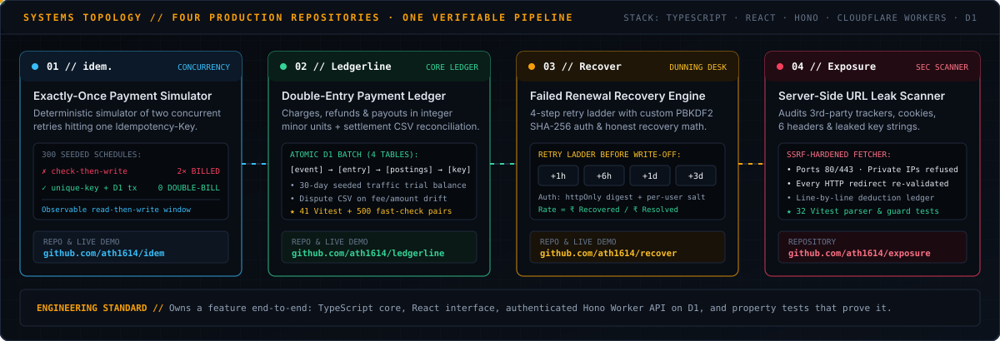
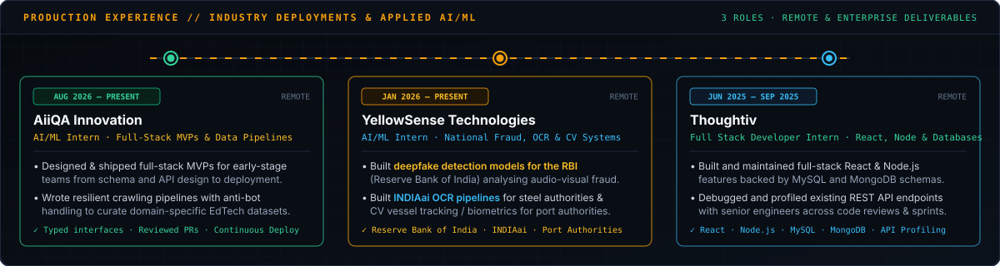
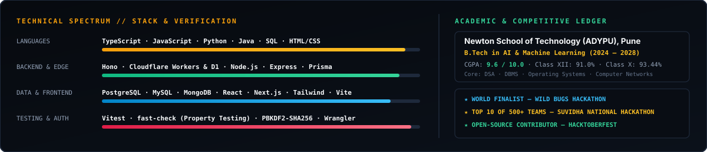

<div align="center">

<!-- ===================================================================== -->
<!-- 1. ANIMATED TELEMETRY HERO BANNER (ZERO-JS DECLARATIVE SVG CONSOLE)   -->
<!-- ===================================================================== -->
<a href="https://github.com/ath1614">
  
</a>

<br/>

<!-- Dynamic Typing Sub-Header (Works out-of-the-box on any GitHub profile) -->
<a href="https://github.com/ath1614">
  
</a>

<!-- Crisp Minimal Contact & Verification Strip -->
<p align="center">
  <a href="https://github.com/ath1614"></a>
  <a href="mailto:atharv.soni@adypu.edu.in"></a>
  <a href="https://github.com/ath1614?tab=repositories"></a>
  <a href="https://github.com/ath1614"></a>
</p>

</div>

---

### `01 // ENGINEERING THESIS`

> **I build payment infrastructure and security tooling where correctness is observable rather than assumed.**  
> Every feature I ship is owned end-to-end: a strictly typed **TypeScript** core, an interactive **React** desk, an authenticated **Hono / Cloudflare Worker API** persisted on **D1**, and deterministic property tests (**Vitest + fast-check**) that prove conservation of value under adversarial schedules.

<div align="center">
  
</div>

---

### `02 // FLAGSHIP SYSTEMS & PROOF OF WORK`

<table>
  <thead>
    <tr>
      <th width="22%">SYSTEM</th>
      <th width="46%">ARCHITECTURAL INVARIANTS &amp; IMPLEMENTATION</th>
      <th width="18%">STACK</th>
      <th width="14%">VERIFICATION</th>
    </tr>
  </thead>
  <tbody>
    <tr>
      <td>
        <strong><a href="https://github.com/ath1614/ledgerline">Ledgerline</a></strong><br/>
        <sub>Double-Entry Payment Ledger</sub>
      </td>
      <td>
        • Models every charge, refund, and payout as a <strong>balanced journal entry in integer minor units</strong> with a trial balance re-derived on every request over 30 days of seeded traffic.<br/>
        • <strong>Idempotent Ingest</strong>: An <code>Idempotency-Key</code> committed inside one atomic D1 batch (<code>event</code>, <code>entry</code>, <code>postings</code>, <code>key</code>) guarantees retries replay the first outcome instead of double-charging.<br/>
        • Reconciles processor settlement files against the books, exporting missing rows, fee drift, and amount drift into a dispute CSV.
      </td>
      <td>
        <code>TypeScript</code><br/>
        <code>React</code> · <code>Hono</code><br/>
        <code>Workers</code> · <code>D1</code>
      </td>
      <td>
        <strong>41 Vitest tests</strong><br/>
        <sub>+ 500 <code>fast-check</code> conservation pairs</sub>
      </td>
    </tr>
    <tr>
      <td>
        <strong><a href="https://github.com/ath1614/exposure">Exposure</a></strong><br/>
        <sub>Server-Side URL Leak Scanner</sub>
      </td>
      <td>
        • Scans a public URL server-side and itemizes what it leaks: third-party scripts, tracker vendors, cookie flags, 6 security headers, form destinations, and key-shaped secrets in markup.<br/>
        • <strong>Explainable Scoring</strong>: Uses a published ledger of fixed deductions per finding so every grade is auditable line-by-line.<br/>
        • <strong>SSRF-Hardened Fetcher</strong>: Enforces <code>http/https</code> on ports <code>80/443</code>, refuses private/reserved IP ranges, and re-validates every redirect hop.
      </td>
      <td>
        <code>TypeScript</code><br/>
        <code>React</code> · <code>Hono</code><br/>
        <code>Workers</code> · <code>D1</code>
      </td>
      <td>
        <strong>32 Vitest tests</strong><br/>
        <sub>Parser, scoring &amp; SSRF guard</sub>
      </td>
    </tr>
    <tr>
      <td>
        <strong><a href="https://github.com/ath1614/idem">idem.</a></strong><br/>
        <sub>Exactly-Once Payment Simulator</sub>
      </td>
      <td>
        • Deterministic simulator of two concurrent retries hitting the same idempotency key, making the <strong>read-then-write race window</strong> observable instead of theoretical.<br/>
        • Benchmarks 4 concurrency strategies across <strong>300 seeded schedules</strong>: proving visually why <em>check-then-write</em> double-bills while a unique key constraint or atomic transaction never does.
      </td>
      <td>
        <code>TypeScript</code><br/>
        <code>React</code><br/>
        <code>Seeded PRNG</code>
      </td>
      <td>
        <strong>300 Seeded</strong><br/>
        <sub>Concurrent schedules</sub>
      </td>
    </tr>
    <tr>
      <td>
        <strong><a href="https://github.com/ath1614/recover">Recover</a></strong><br/>
        <sub>Dunning Desk for Failed Payments</sub>
      </td>
      <td>
        • Operational recovery desk where failed subscription renewals land with decline codes and step down a <strong>4-stage retry ladder (1h → 6h → 1d → 3d)</strong> before write-off.<br/>
        • <strong>Hand-Rolled Security Layer</strong>: <code>PBKDF2-SHA256</code> with per-user salt, <code>httpOnly</code> session digests, strict same-origin mutation checks, and a 5-attempt login lockout.<br/>
        • Honest recovery math: <code>₹ Recovered / ₹ Resolved</code> (open queues cannot artificially inflate rate).
      </td>
      <td>
        <code>React</code> · <code>Hono</code><br/>
        <code>Workers</code> · <code>D1</code><br/>
        <code>PBKDF2 Auth</code>
      </td>
      <td>
        <strong>22 Seeded</strong><br/>
        <sub>Deterministic invoices/acct</sub>
      </td>
    </tr>
  </tbody>
</table>

<details>
<summary><strong>🔍 Deep-Dive: Why My Payment Systems Use Atomic Batches &amp; Integer Minor Units (Click to Expand)</strong></summary>
<br/>

```typescript
// Conservation of Value Property Invariant (Ledgerline — Vitest + fast-check)
// For any generated charge amount & processor fee in minor units (paise/cents):
//   DEBIT(processor_clearing) === CREDIT(merchant_payable) + CREDIT(platform_fee_revenue)
//   Net Ledger Drift across all postings === 0n

export interface AtomicIngestBatch {
  readonly idempotencyKey: string;
  readonly event: PaymentEventRecord;
  readonly journalEntry: JournalEntryRecord;
  readonly postings: readonly [DebitPosting, CreditPosting, FeeCreditPosting];
}
```

- **Zero Floating-Point Drift**: All monetary arithmetic runs strictly in integer minor units (`paise` / `cents`), eliminating IEEE-754 rounding discrepancies during settlement reconciliation.
- **Single-Roundtrip Atomicity on Edge SQLite (D1)**: By binding the `Idempotency-Key` insertion and the journal postings into a single atomic batch, a retry arriving mid-flight either hits the unique key constraint and replays the stored response or commits cleanly once.

</details>

---

### `03 // PRODUCTION EXPERIENCE & APPLIED AI/ML`

<div align="center">
  
</div>

---

### `04 // TECHNICAL SPECTRUM, EDUCATION & HONORS`

<div align="center">
  
</div>

---

### `05 // LIVE GITHUB TELEMETRY`

<div align="center">
  <picture>
    <source media="(prefers-color-scheme: dark)" srcset="https://github-readme-streak-stats.herokuapp.com/?user=ath1614&theme=tokyonight&hide_border=true&background=070A0F&stroke=1E293B&ring=F59E0B&fire=F59E0B&currStreakLabel=34D399" />
    
  </picture>
  <picture>
    <source media="(prefers-color-scheme: dark)" srcset="https://github-readme-stats.vercel.app/api/top-langs/?username=ath1614&layout=compact&theme=tokyonight&hide_border=true&bg_color=070A0F&title_color=F59E0B&text_color=CBD5E1" />
    
  </picture>
</div>

<br/>

<div align="center">
  <sub>
    <strong>Atharv Soni</strong> · Pune, India · <a href="mailto:atharv.soni@adypu.edu.in">atharv.soni@adypu.edu.in</a> · <a href="https://github.com/ath1614">github.com/ath1614</a><br/>
    <em>"Every animated pixel represents a real invariant — conservation of value, idempotent execution, and verifiable security."</em>
  </sub>
</div>
